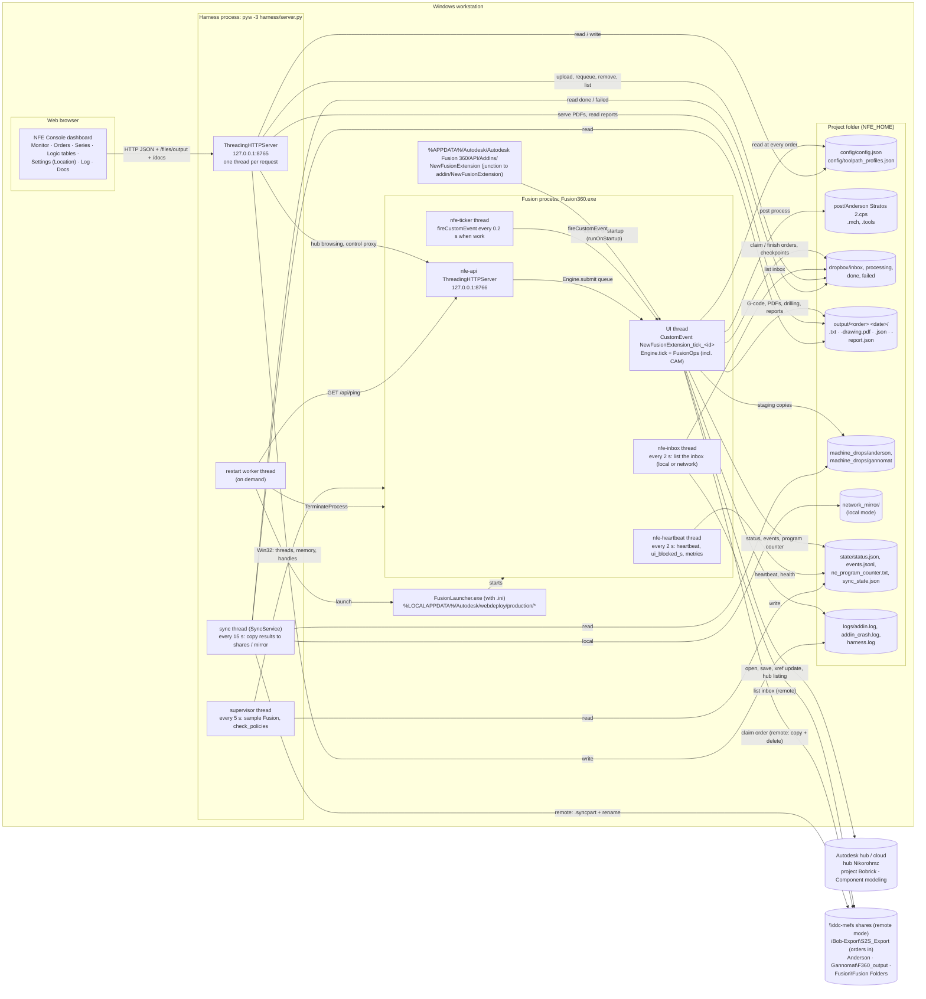

# NewFusionExtension infrastructure

Processes, ports, threads, files and external systems, and how the Python
modules depend on each other. A pre-rendered SVG of the first diagram is in
[infrastructure.svg](infrastructure.svg) (drawn by `scripts/gen_diagrams.py`). Details: [ARCHITECTURE.md](ARCHITECTURE.md).
Every directory in local and remote mode: [tables/DIRECTORIES.md](tables/DIRECTORIES.md).

---

## 1. Runtime infrastructure

### Ports

| Port | Bound by | Bind address | Configured by | Clients |
|---|---|---|---|---|
| 8765 | Harness (`harness/server.py`) | `api.harness_bind`, default `127.0.0.1` | `api.harness_port`, `--port`, `--host` | Browser (dashboard) |
| 8766 | Add-in (`nfe/api_server.py`) | `127.0.0.1` (fixed) | `api.addin_port` | Harness, `tests/live/run_order.py`, `scripts/fusion_exec.py` |

Both servers accept POST/PUT only with `Content-Type: application/json` and a
same-site (or no) `Origin`. The unit tests use port 0 (random) for the harness
and `api.addin_port = 59987` in their sandbox config, so they never touch the
live add-in.

### Processes and threads

| Process | Threads | Started by |
|---|---|---|
| `Fusion360.exe` | UI thread (all Fusion API work, including CAM and posting), `nfe-ticker`, `nfe-heartbeat`, `nfe-inbox`, `nfe-api` + request threads | FusionLauncher (user, or harness restart worker); add-in loaded by Fusion from the AddIns junction (a second registration of the same add-in is ignored by the single-instance guard) |
| Harness (`pyw -3 harness/server.py`) | main (HTTP), `supervisor`, sync thread, `restart` (on demand), request threads | `start_harness.bat`, or the add-in when `api.launch_harness_from_addin` is true |
| Browser | — | User opens http://127.0.0.1:8765 |

### Shared files

| Path | Writer | Readers | Format |
|---|---|---|---|
| `config/config.json` | Harness (`PUT /api/config`, location switch), editor | Add-in (every order, `reload_config`), harness | JSON, deep-merged over `nfe.config.DEFAULTS` |
| `config/toolpath_profiles.json` | Harness (`PUT /api/logic/profiles`) | Add-in (every order), harness | `{"profiles": [...]}`; absent = built-in `nfe/cam_defaults.py` |
| `post/Anderson Stratos 2.cps` | — | Add-in (`cam.post_processor`) | Fusion post processor |
| inbox (`dropbox/inbox` or the iBob share) | User, harness upload, iBob export | Add-in (claim) | Order JSON |
| `dropbox/processing/*.json`, `*.state.json` | Add-in | Add-in (resume), harness | Order + checkpoint (incl. `output_folder`) |
| `dropbox/done|failed/*.json`, `*.report.json` | Add-in | Harness, sync | Order + report |
| `output/<order> <date>/` | Add-in | Harness (`/files/output/`), sync, user | `1-<comp>-<order>.txt`, `1-<comp>-<order>-drawing.pdf`, `<order>.json`, `<order>-report.json` |
| `machine_drops/anderson`, `machine_drops/gannomat` | Add-in | Sync | Flat copies of G-code / drilling files |
| `network_mirror/` | Sync (local mode) | Operator | Local stand-in for the shares |
| `state/status.json` | Add-in (UI, heartbeat, inbox threads) | Harness | JSON, atomic replace |
| `state/events.jsonl` (+ `.1`) | Add-in | Harness `/api/events` | JSON lines, rotated at 5 MiB |
| `state/nc_program_counter.txt` | Add-in (`gcode.ProgramCounter`) | Add-in | Last program number (seeded from the old pipeline's counter) |
| `state/sync_state.json` | Sync | Sync | Files already copied (path → mtime, size) |
| `logs/addin.log`, `logs/addin_crash.log`, `logs/harness.log` | Add-in / harness | Operator | Text |

All JSON writes except the event log use `nfe.jsonio.write_json_atomic`: a
temporary file in the same folder, then `os.replace` retried up to 20 times.
G-code is written with `gcode.write_program` (binary, CRLF, atomic); the sync
copies through `<name>.syncpart` + rename so a machine never sees a partial
file.

### External systems

| System | Used for | Accessed from |
|---|---|---|
| Autodesk Fusion (desktop) | Models, drawings, parameters, saving, drawing reference update, PDF export, MANUFACTURE workspace, toolpath generation, post processing | `nfe/fusion_ops.py` on the UI thread |
| Autodesk hub / cloud | Resolving files by lineage id, new model versions, hub listings | Through the Fusion API (`app.data`) only |
| `\\ddc-mefs` shares (remote mode) | Order inbox (read + claim); G-code, drilling, output and finished orders (written by the sync service only) | Add-in inbox thread / claim; harness `SyncService` |
| FusionLauncher (webdeploy) | Starting Fusion | Harness `_launch_fusion` |
| cdn.jsdelivr.net, Google Fonts | Markdown/Mermaid rendering on the Docs and Logic tabs; fonts (optional) | Browser |

---

## 2. Module dependencies

Arrows point from the importing module to the imported one. Dashed arrows are
HTTP calls, not imports.

```mermaid
flowchart TD
    subgraph ADDIN["addin/NewFusionExtension"]
        entry["NewFusionExtension.py<br/>(Host, ticker, single-instance guard)"]
        subgraph NFE["nfe package"]
            addin_main["addin_main<br/>AddinApp"]
            api_server["api_server"]
            engine["engine<br/>Engine, Task, Sleep, WaitFor"]
            fusion_ops["fusion_ops<br/>FusionOps (incl. CAM)"]
            fake_ops["fake_ops<br/>FakeOps"]
            ops_base["ops_base"]
            cam_rules["cam_rules<br/>toolpath tables"]
            cam_defaults["cam_defaults<br/>DEFAULT_PROFILES"]
            expr["expr<br/>safe expressions"]
            gcode["gcode<br/>splice, ProgramCounter"]
            drilling["drilling<br/>Gannomat records"]
            naming["naming<br/>Namer"]
            sync["sync<br/>SyncService"]
            orders["orders"]
            params["params"]
            rules["rules"]
            config["config"]
            dropbox["dropbox"]
            state["state"]
            jsonio["jsonio"]
            winproc["winproc"]
            paths["paths"]
        end
    end

    subgraph HARNESS["harness"]
        server["server.py<br/>Harness, route"]
        static["static/app.js"]
    end

    tests["tests/test_*.py + helpers.py"]
    live["tests/live/run_order.py"]
    fexec["scripts/fusion_exec.py"]
    adsk[["adsk.core / fusion / drawing / cam<br/>(Fusion only)"]]

    entry -. "reloadable import" .-> addin_main
    entry --> adsk
    addin_main --> engine
    addin_main --> fusion_ops
    addin_main --> api_server
    addin_main --> config
    addin_main --> dropbox
    addin_main --> paths
    addin_main --> state
    addin_main --> winproc
    addin_main --> adsk
    engine --> cam_rules
    engine --> cam_defaults
    engine --> gcode
    engine --> drilling
    engine --> naming
    engine --> rules
    engine --> config
    engine --> dropbox
    engine --> orders
    engine --> params
    engine --> jsonio
    cam_rules --> rules
    cam_rules --> cam_defaults
    cam_rules --> expr
    gcode --> jsonio
    drilling --> jsonio
    sync --> jsonio
    config --> jsonio
    config --> naming
    dropbox --> jsonio
    state --> jsonio
    fusion_ops --> ops_base
    fusion_ops --> params
    fusion_ops --> winproc
    fusion_ops --> adsk
    fake_ops --> ops_base
    fake_ops --> params

    server --> config
    server --> rules
    server --> cam_rules
    server --> cam_defaults
    server --> drilling
    server --> gcode
    server --> naming
    server --> sync
    server --> dropbox
    server --> orders
    server --> paths
    server --> state
    server --> winproc
    static -. "HTTP 8765" .-> server
    server -. "HTTP 8766" .-> api_server

    tests --> engine
    tests --> fake_ops
    tests --> server
    live -. "HTTP 8766" .-> api_server
    fexec -. "HTTP 8766 /api/dev/exec" .-> api_server
```

Layering rules that follow from the graph:

* Only `NewFusionExtension.py`, `addin_main` and `fusion_ops` import `adsk`.
  Everything the harness and the tests import is plain Python.
* `engine` depends on the `Ops` interface only through the object it is given;
  `addin_main` injects `FusionOps`, the tests inject `FakeOps`.
* The decision logic (`cam_rules` + `cam_defaults` + `expr`, `drilling`,
  `gcode`, `naming`) is pure Python, shared by the add-in (to execute it) and
  the harness (to show it on the Logic tables tab and test inputs), so the
  dashboard always shows what the add-in will do.
* `NewFusionExtension.py` imports `nfe.addin_main` inside `Host._load_impl`
  after deleting all `nfe.*` modules from `sys.modules`, which is what makes
  in-place reload possible.
