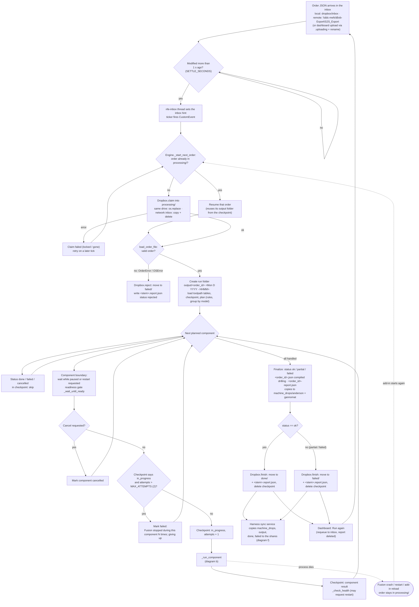
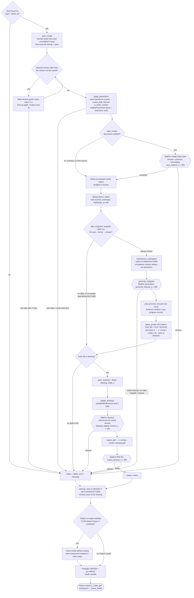
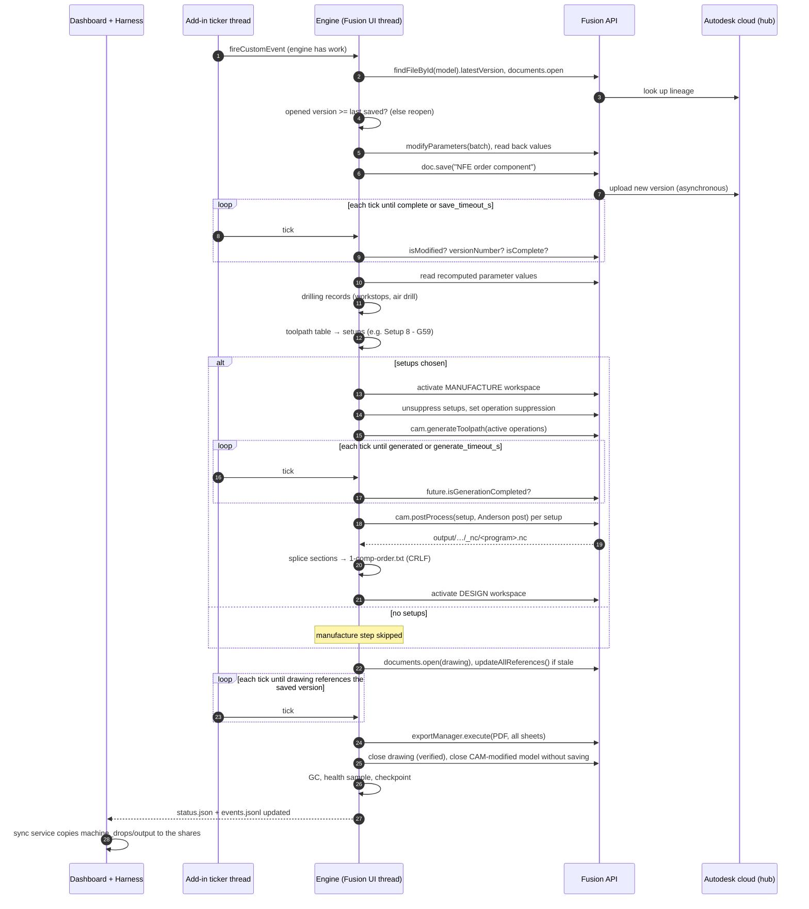
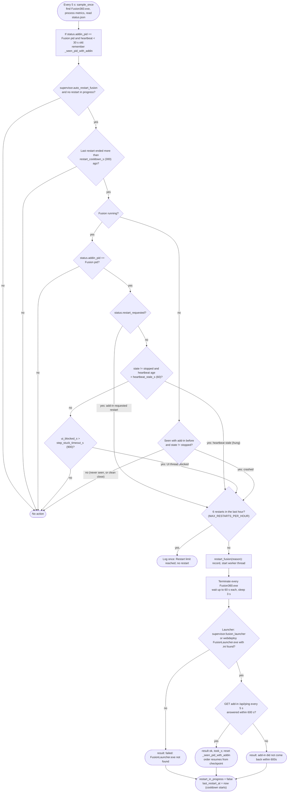
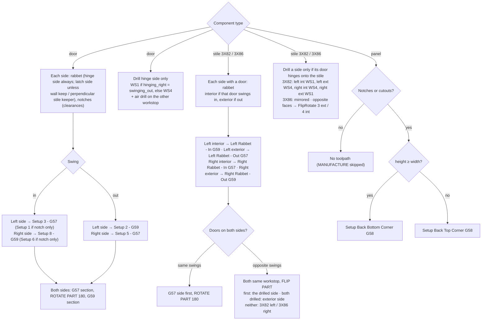
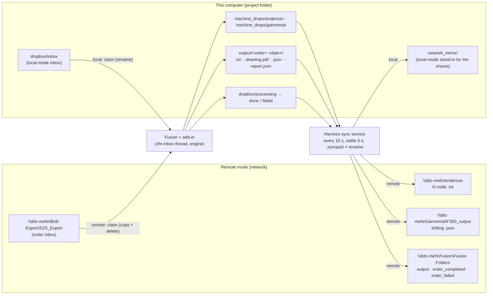

# NewFusionExtension workflow diagrams

Mermaid diagrams of how orders and components move through the system. The
text reference for every step is [ARCHITECTURE.md](ARCHITECTURE.md); section
numbers below refer to it. The selection rules in plain words are in
[tables/SELECTION_LOGIC.md](tables/SELECTION_LOGIC.md). A pre-rendered SVG of
diagram (b) is in [workflow.svg](workflow.svg) for viewers without Mermaid
(drawn by `scripts/gen_diagrams.py`; edit that script, not the SVG).

---

## (a) Order lifecycle: inbox → processing → done / failed

Code: `nfe/dropbox.py` (`Dropbox`), `nfe/engine.py` (`Engine._start_next_order`,
`Engine._order_gen`, `Engine._finalize_outputs`), `nfe/naming.py`. See
ARCHITECTURE.md sections 6 and 8.

Notes:

* Rejected orders never create an output folder.
* A cancelled component counts as failed for the order status.
* Components that were never reached are reported as `skipped`.
* An exception outside the per-component handler pauses the engine
  (`internal error: ...`); the order stays in `processing/`.

---

## (b) Per-component step flow

Code: `Engine._run_component`, `Engine._component_steps`, `Engine._get_model`,
`Engine._drilling`, `Engine._manufacture`, `Engine._after_component`,
`FusionOps`. See ARCHITECTURE.md section 7. Hexagons are waits (with the
config key and default).

---

## (c) Sequence of one component

Participants: the dashboard and harness, the add-in's ticker thread, the
engine on Fusion's UI thread, the Fusion API, and the Autodesk cloud. Each
engine activation is one tick; between ticks Fusion processes its own events
(uploads, toolpath generation, regeneration, UI).

---

## (d) Supervisor restart decision flow

Code: `Harness._supervise`, `Harness.sample_once`, `Harness.check_policies`,
`Harness._restart_worker` in `harness/server.py`. Runs every 5 s
(`SAMPLE_S`). See ARCHITECTURE.md section 12.3.

A dashboard "Restart Fusion" starts `restart_fusion` directly (no cooldown,
no hourly cap; 409 if one is already running). "Start Fusion" (shown when
Fusion is not running) only launches it.

---

## (e) Toolpath, workstop and drilling selection (per side)

Code: `nfe/cam_defaults.py` (tables), `nfe/cam_rules.py`, `nfe/drilling.py`.
Plain-words version: [tables/SELECTION_LOGIC.md](tables/SELECTION_LOGIC.md).
At most one setup per side; panels one setup by orientation.

---

## (f) Location modes and network sync

Code: `nfe/paths.py` (`Paths.apply_location`), `nfe/dropbox.py`
(`Dropbox.claim`), `nfe/sync.py` (`SyncService`), `harness/server.py`
(`Harness.location`, `set_location_mode`, `sync_action`). Fusion only ever
writes to this computer; the harness copies results out.

